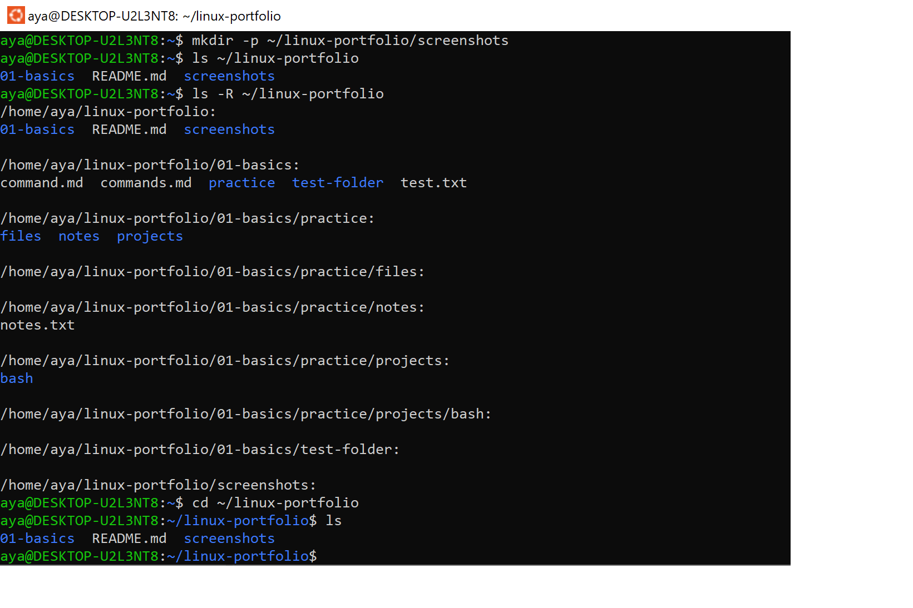

# My Linux Learning Portfolio

## About This Project
This repository documents my journey learning Linux, practicing system administration basics, and developing Bash scripting skills.

## Environment
- Operating system: Ubuntu on WSL
- Shell: Bash

## Skills Practiced
- Navigating the Linux filesystem
- Managing files and directories
- Searching for files and text
- Inspecting file information and permissions
- Managing processes
- Learning package management with APT
- Using pipes and redirection
- Practicing networking commands
- Writing Bash scripts

## Projects

### 1. Linux Command Journal
A collection of Linux commands, examples, and practical exercises.

[Open the command journal](01-basics/commands.md)

### 2. System Information Report
A Bash script that displays basic system information, including the current user, hostname, kernel version, disk usage, and memory usage.

[Project instructions](02-projects/system-info/README.md)

[View the Bash script](02-projects/system-info/system_info.sh)

## Screenshot

